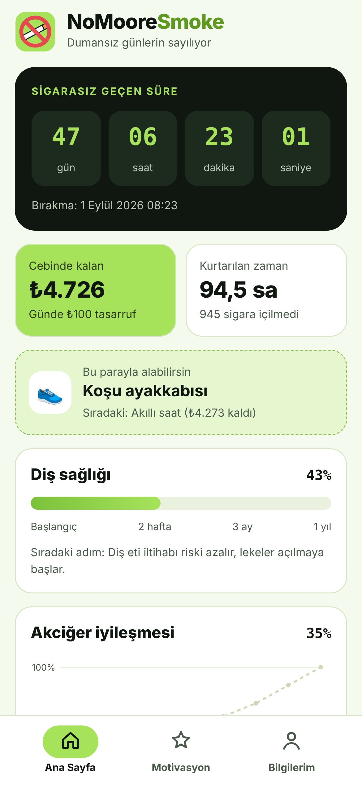
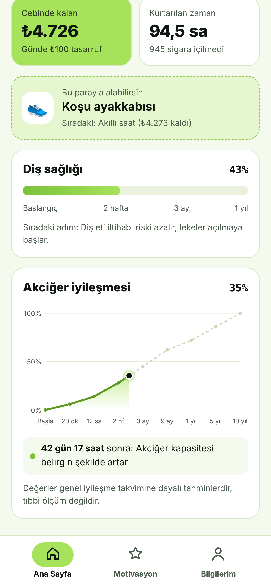
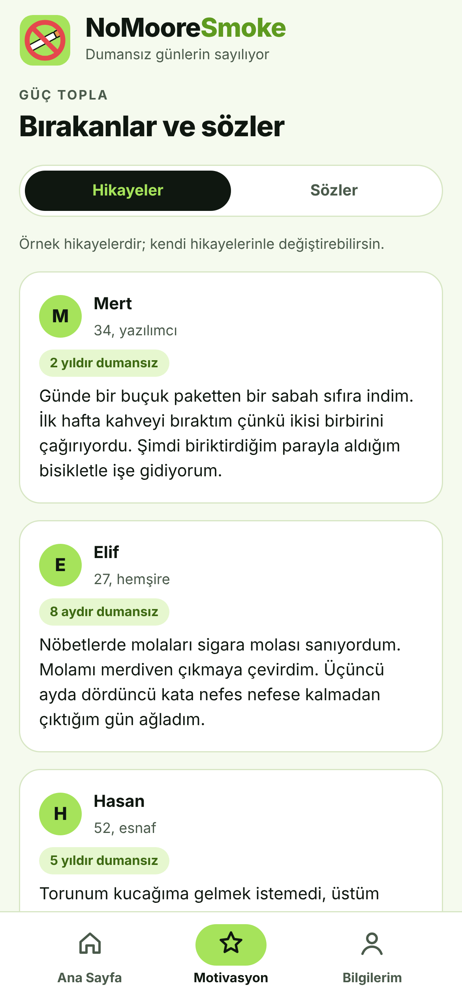
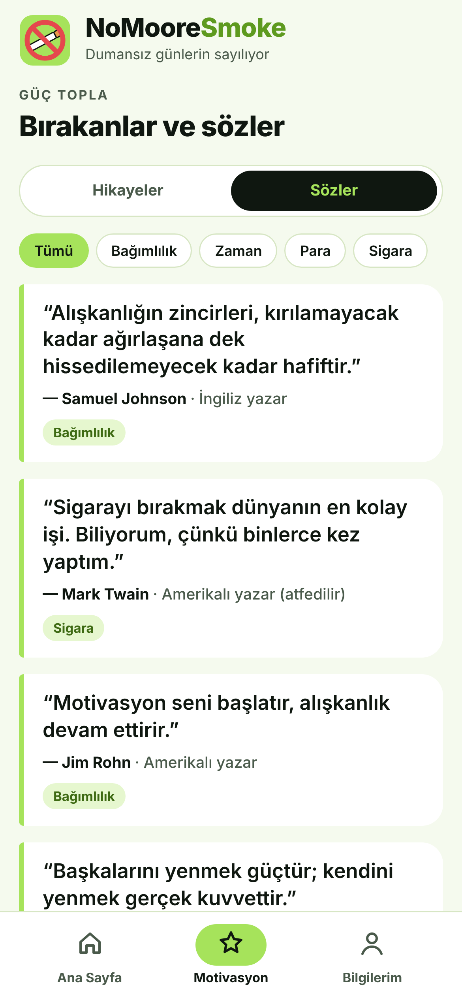
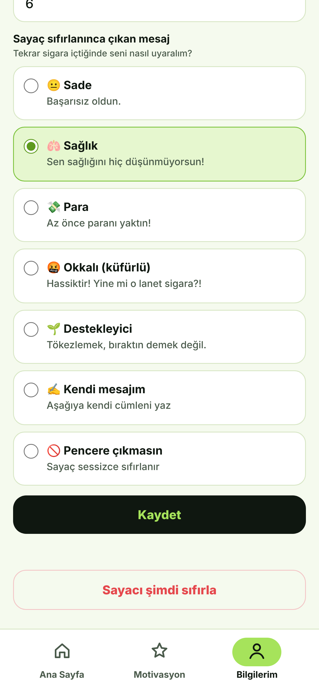
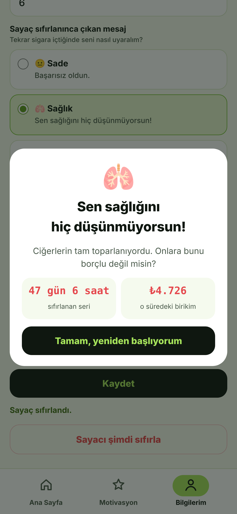
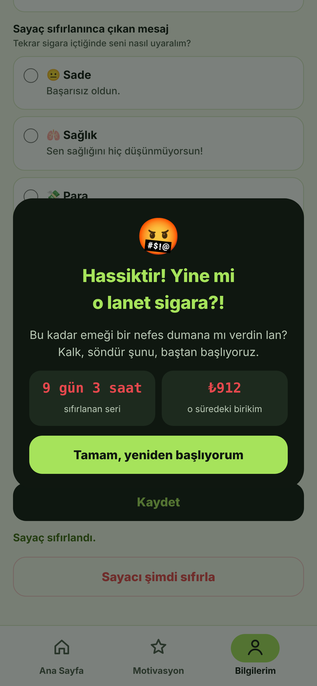

# NoMooreSmoke (Web)

  

<h1 align="center">NoMooreSmoke</h1>

Sigarasız geçen süreni, cebinde kalan parayı ve sağlığındaki iyileşmeyi takip et.

## Ekran görüntüleri

<table>
  <tr>
    <td align="center"> <b>Ana Sayfa</b></td>
    <td align="center"> <b>Diş ve akciğer sağlığı</b></td>
    <td align="center"> <b>Hikayeler</b></td>
  </tr>
  <tr>
    <td align="center"> <b>Sözler</b></td>
    <td align="center"> <b>Bilgilerim</b></td>
    <td align="center"> <b>Sıfırlama penceresi</b></td>
  </tr>
  <tr>
    <td align="center"> <b>Okkalı mod</b></td>
    <td></td>
    <td></td>
  </tr>
</table>

iPhone ve Android'de ana ekrana eklenebilen, internetsiz de açılan sigara bırakma uygulaması.

## Dosyalar
- `index.html` – uygulamanın kendisi
- `manifest.webmanifest` – ad, simge ve tam ekran ayarı
- `sw.js` – internetsiz açılmayı sağlar
- `icon-192.png`, `icon-512.png`, `apple-touch-icon.png` – simgeler

## GitHub Pages ile yayınlama
1. github.com'da **New repository** → adı `NoMooreSmoke` → **Public** → **Create repository**.
2. Açılan sayfada **uploading an existing file** bağlantısına tıkla, bu klasördeki tüm dosyaları sürükleyip bırak → **Commit changes**.
3. Repo'da **Settings → Pages** → *Source*: **Deploy from a branch**, *Branch*: **main** / **(root)** → **Save**.
4. 1-2 dakika sonra adres hazır olur: `https://KULLANICI-ADIN.github.io/NoMooreSmoke/`

## iPhone'a kurma
1. Linki **Safari** ile aç (Chrome'da ana ekrana ekleme sınırlı).
2. Alttaki **Paylaş** düğmesi → **Ana Ekrana Ekle** → **Ekle**.
3. Ana ekrandaki NoMooreSmoke simgesinden aç; tam ekran uygulama gibi çalışır.

## Android'e kurma
Chrome'da linki aç → sağ üst menü → **Ana ekrana ekle** (veya **Uygulamayı yükle**).

## Notlar
- Girilen bilgiler yalnızca o telefonda saklanır, hiçbir yere gönderilmez.
- Safari'nin geçmiş/site verilerini silmek uygulamadaki bilgileri de siler.
- Güncelleme yapınca dosyaları repoya tekrar yükle; uygulama bir sonraki açılışta yeni sürümü alır.
